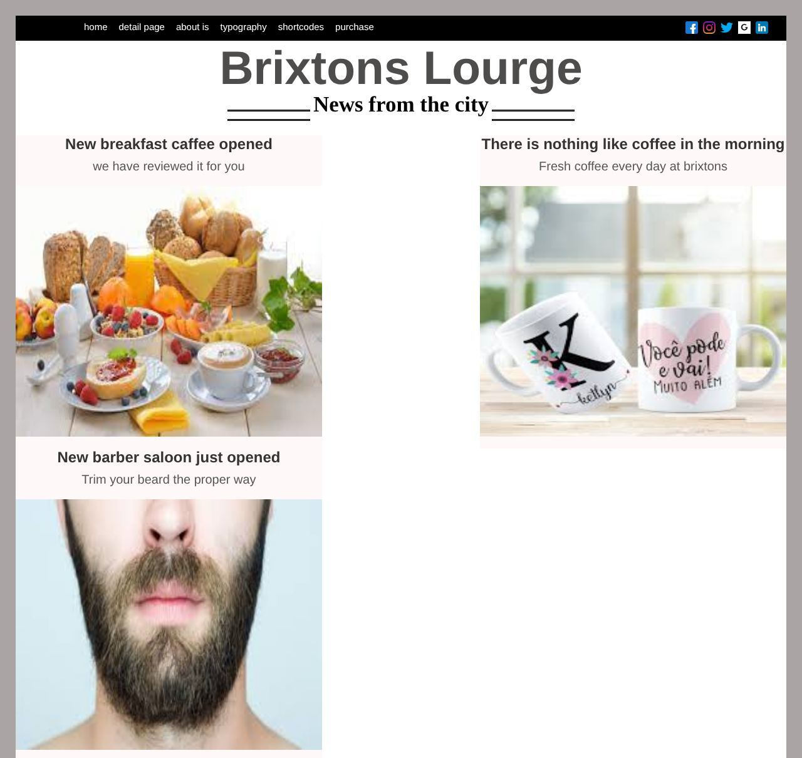

# blog-simples

[Português](README.pt-BR.md)

A static blog page in HTML and CSS that recreates the layout of a reference image ("Brixtons Lounge"). It was my third project as a beginner, built with help from ChatGPT.

> **Type:** study project (2023)



## What it has

- Navigation bar with sample links and social media icons.
- Title, subtitle framed by double lines and three article cards with images.
- A "Brand new selection of fashion" section and an "About Me" block with lorem ipsum text.
- Footer linking to the author's GitHub profile.

## How to open

No dependencies or build step. Open `rjs/blog/indexx.html` in a browser or serve the folder:

```bash
cd rjs/blog
python3 -m http.server 8000   # then visit http://localhost:8000/indexx.html
```

## Structure

- `rjs/blog/indexx.html`: the page.
- `rjs/blog/style.css`: styles.
- `rjs/blog/imagens/`: photos and icons.
- `rjs/blog/blog copia.png`: layout reference image.

## Limitations

- Not responsive (fixed, desktop-oriented layout).
- Menu items are placeholders (`href=""`, most with the text outside the link) and the social icons are not linked.
- Differences from the reference, such as "Brixtons Lourge" in the title and "about is" in the menu.

## Credits and image origin

- The layout follows `blog copia.png`, a mockup of a third-party blog theme; its author is not documented.
- Photos and icons were collected from the web and their origin is not documented. `imagens/img1.jpg` carries an iStock watermark (unlicensed preview). Replace the images with licensed material before any reuse.

## Security

See [SECURITY.md](SECURITY.md).

## License

No license has been chosen yet; all rights reserved by the author (this does not cover the third-party images mentioned above).
